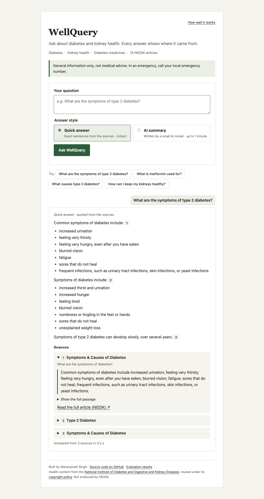

# WellQuery

WellQuery answers general questions about diabetes, kidney health and diabetes medicines. It only uses 15 articles from the U.S. National Institute of Diabetes and Digestive and Kidney Diseases (NIDDK), and every answer shows the exact passage it came from, with a link to the original article.

It is a university project and is not medical advice.

<p align="center"></p>

## What it does

- Finds the parts of the articles that match your question, using keyword search and meaning-based search together.
- **Quick answer** (default): shows the most relevant sentences exactly as written in the articles, with numbered links to each source.
- **AI summary** (optional): a small language model (Qwen2.5 1.5B, run locally through Ollama) writes a short answer. Each sentence must point to a real sentence from the sources, or the answer is hidden.
- Refuses emergencies (it tells you to call emergency services) and personal medical questions such as "how much insulin should I take".
- Says so when the articles don't cover a question, instead of guessing.
- Has a page showing how well the search did on 92 test questions.

## Running it

**With Docker:**

```sh
make docker && make docker-run
```

Then open http://127.0.0.1:7860. The first build downloads the language model (about 1 GB). Quick answers take a few seconds at most; summaries can take up to a minute on a normal CPU.

**Without Docker** (needs Python 3.12, [uv](https://docs.astral.sh/uv/) and `make`):

```sh
make setup     # install dependencies
make ingest    # download the 15 articles
make index     # build the search index
make local     # start the app at http://127.0.0.1:8000
```

For summaries, also run `make model-serve` in a second terminal, then `make model-pull` once, and set `OLLAMA_MODEL=qwen2.5:1.5b` in `.env`.

## Built with

Python, FastAPI, SQLite, BM25 keyword search, MiniLM sentence embeddings, Ollama with Qwen2.5 1.5B, plain HTML/CSS/JavaScript, pytest, Docker and GitHub Actions.

## Tests

```sh
make check
```

This runs the automated tests and a whitespace check. `make evaluate` re-runs the main set of 60 test questions.

## Limits

- It only knows what is in the 15 articles. It is not a full health or drug reference.
- The 92 test questions are drafts that no person has checked yet, so the results page is a development check, not a measure of medical accuracy.
- The safety rules work on wording and can miss questions phrased in unexpected ways.
- Please don't enter personal health information.

## Sources and history

The health content comes from NIDDK and is reused under its [copyright policy](https://www.niddk.nih.gov/copyright). WellQuery is not endorsed by NIDDK. Source details are in [data/README.md](data/README.md).

WellQuery grew out of my earlier project, MediBot, which used Databricks and Llama. That setup is still in the code as an option (`BACKEND_MODE=databricks`) but is off by default. See [ATTRIBUTION.md](ATTRIBUTION.md).

More detail: [design notes](docs/ARCHITECTURE.md), [evaluation](evaluation/README.md), [report](docs/REPORT.md).
